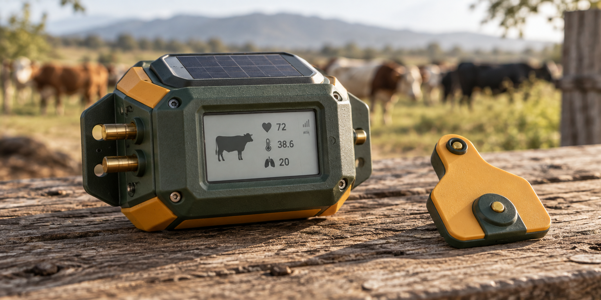

<div align="center">
  
</div>

<p align="center">
  <a href="https://diufoundry.online"></a>&nbsp;
  &nbsp;
  &nbsp;
  
</p>

<p align="center">
  <b>Precision livestock economics, biometric health telemetry, and predictive herd simulation.</b><br/>
  <em>A multilingual operational workbench helping rural farmers track livestock economics, breeding cycles, and clinical health trends.</em>
</p>

---

## ✦ System Overview

**Cattle Care for Farmers** is an empirical agricultural operating system engineered by DIU Foundry. Moving past simple animal registries, it equips farmers with decision intelligence: calculating herd feed conversion ratios, forecasting breeding revenue, running what-if climate/economic simulations, and monitoring daily herd biometrics in native regional languages.

```text
 ┌─────────────────────────────────────────────────────────────────────────────┐
 │                         HERD DECISION INTELLIGENCE                          │
 ├─────────────────────┬───────────────────────────────┬───────────────────────┤
 │ BIOMETRIC TELEMETRY │ PREDICTIVE WHAT-IF SIMULATION │ MULTILINGUAL SUPPORT  │
 │ Vitals: 98.4% Normal│ Breeding Margin: +18.2% Est.  │ i18n: Regional Native │
 └─────────────────────┴───────────────────────────────┴───────────────────────┘
```

---

## 🌾 Architecture & Agricultural Telemetry

```text
[ FARMER INPUT / EAR-TAG SENSORS ]
        │
        ▼
[ MULTILINGUAL LOCALIZATION BUS ] (`src/i18n/`)
        │
        ▼
[ HERD TELEMETRY STATE ] (`src/context/`)
        │
        ├─► [ ANIMAL PROFILE & VITALS ] (`src/pages/AnimalProfile.tsx`, `Health.tsx`)
        │
        ├─► [ BREEDING & GENETICS ENGINE ] (`src/pages/Breeding.tsx`)
        │
        ├─► [ HERD ECONOMICS & PRODUCTIVITY ] (`src/pages/Economics.tsx`, `Productivity.tsx`)
        │
        └─► [ WHAT-IF SCENARIO SIMULATOR ] (`src/pages/WhatIfSimulation.tsx`)
```

---

## ✦ Core Capabilities

- **Decision Intelligence Engine** (`src/pages/DecisionIntelligence.tsx`) — Algorithmic livestock recommendations factoring in lactation stages, feeding costs, and clinical symptoms.
- **Predictive What-If Simulations** (`src/pages/WhatIfSimulation.tsx`) — Interactive scenario modeler calculating herd output under changing feed prices and seasonal conditions.
- **Multilingual Accessibility** (`src/i18n/`) — Seamless language switching designed for local rural communities.
- **Biometric Health Logging** (`src/pages/Health.tsx`) — Structured tracking of vaccination cycles, clinical veterinary observations, and recovery timetables.

---

## 🛠️ Project Structure

```text
CattleappforFormers/
├── public/                 # Livestock illustrations, regional icons & sound cues
├── src/
│   ├── components/         # Metric cards, simulation sliders & vitals charts
│   ├── context/            # Herd state management & offline-first cache
│   ├── i18n/               # Localization bundles & dialect translation
│   ├── pages/              # Farmer operational views
│   │   ├── Dashboard.tsx            # Main herd status overview
│   │   ├── AnimalProfile.tsx        # Individual bovine history & pedigree
│   │   ├── Breeding.tsx             # Insemination & calving timelines
│   │   ├── Economics.tsx            # Milk yield revenue vs feed expenses
│   │   ├── DecisionIntelligence.tsx # Actionable agricultural advisories
│   │   └── WhatIfSimulation.tsx     # Economic forecasting sandbox
│   ├── services/           # Diagnostic telemetry APIs & export generators
│   └── types/              # Bovine biometrics & financial data contracts
└── package.json            # React 18, Vite, Framer Motion, i18next, Lucide
```

---

## ⚡ Quickstart

```bash
# Clone repository
git clone https://github.com/Kishordiu/CattleappforFormers.git
cd CattleappforFormers

# Install dependencies
npm install  # or bun install

# Launch agricultural workbench
npm run dev
```

Navigate to [http://localhost:5173](http://localhost:5173) to explore the herd decision workspace.

---

<p align="center">
  <b>RESEARCH → BUILD → TEST → SHIP</b><br/>
  <sub>An agritech initiative by <a href="https://diufoundry.online">DIU Foundry</a> · Engineered by K. Kishor Kumar</sub>
</p>
